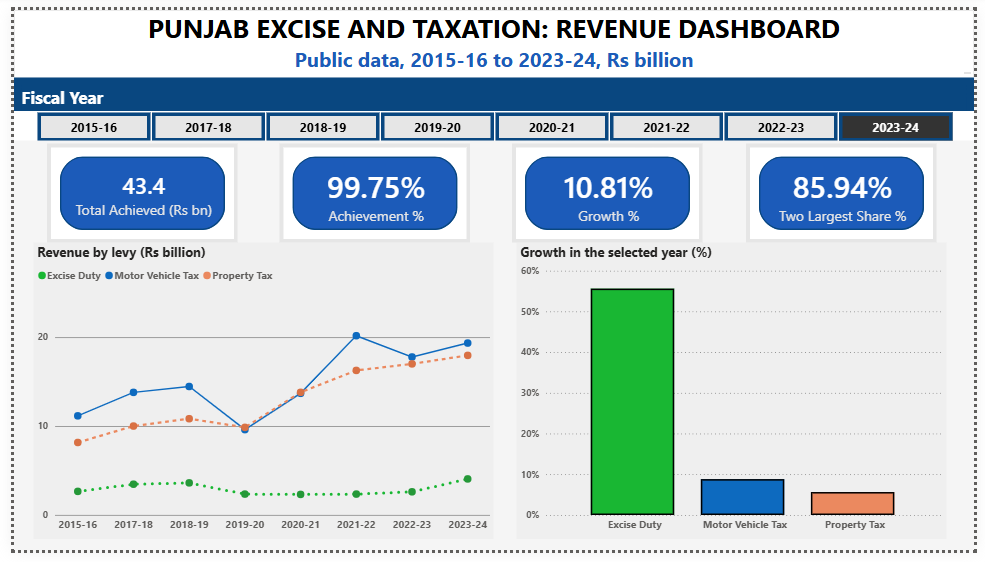
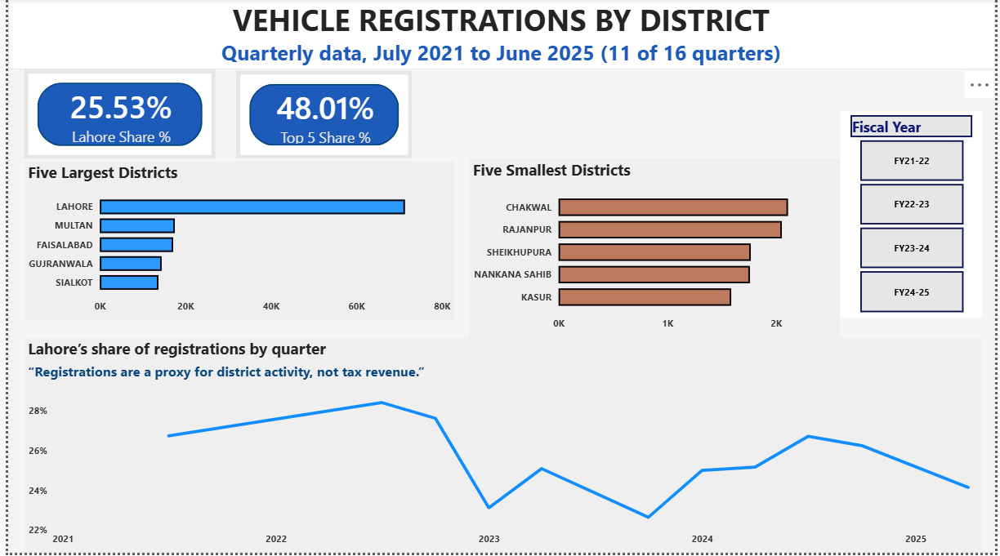
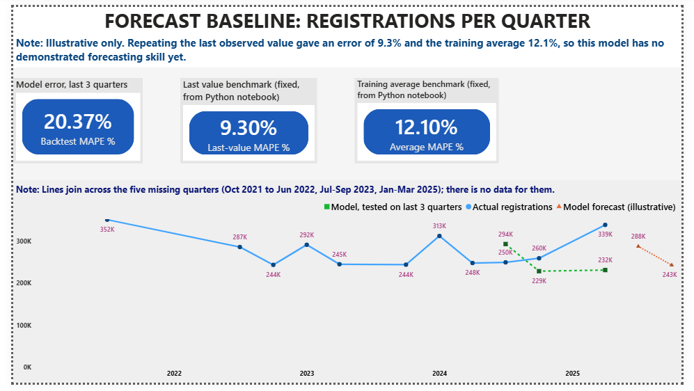
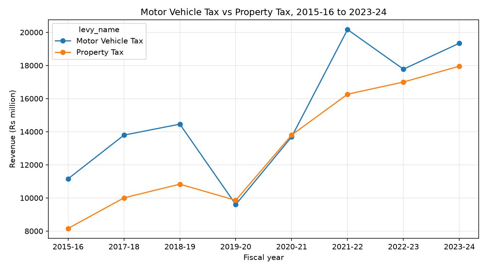
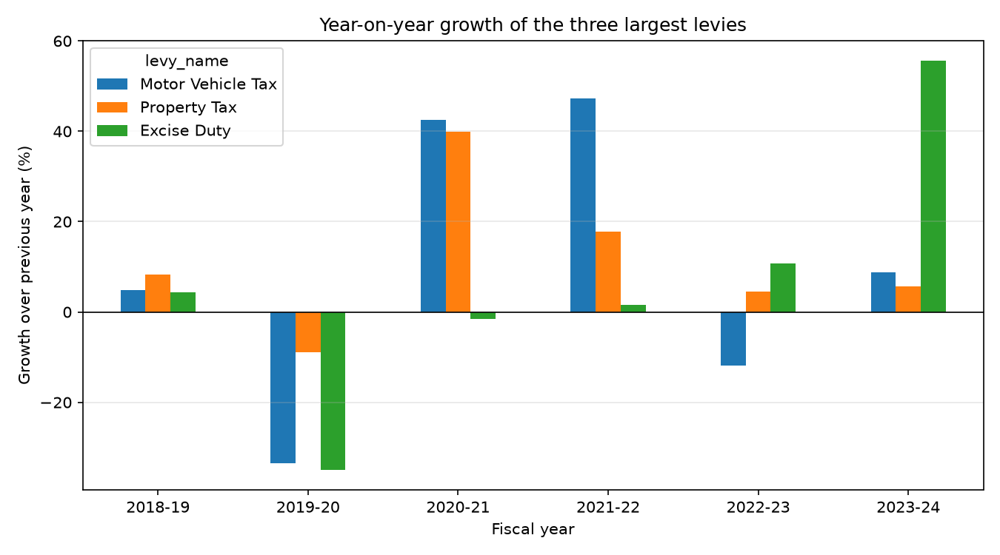
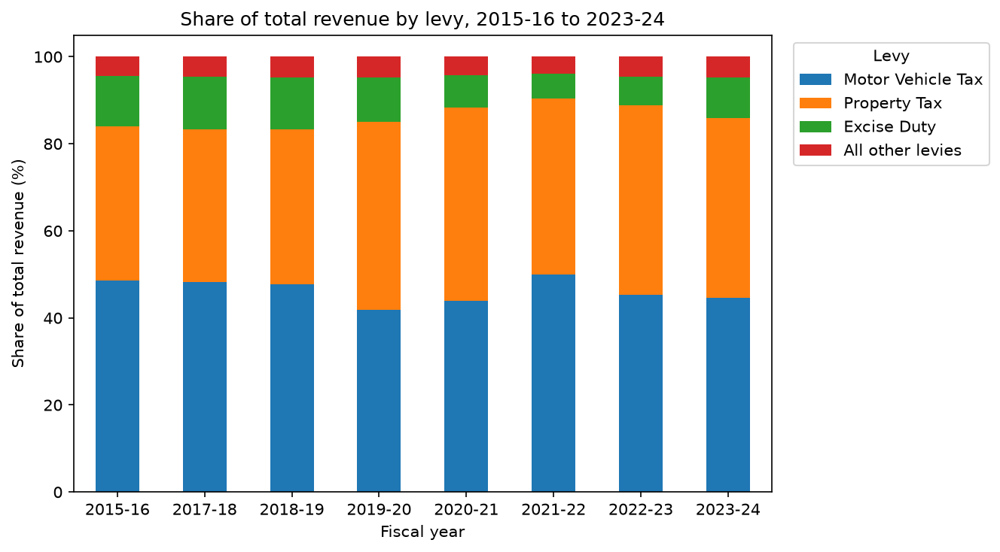

# Predictive Analytics for Tax Revenue Forecasting (Punjab)

A data analysis and forecasting project on provincial tax revenue and vehicle
registrations, built from publicly disclosed government data. It combines a
Python analysis notebook with a three-page interactive Power BI dashboard.

> Analysis of publicly disclosed data under the Right to Information Act, 2013.
> Personal academic work; views are my own and do not represent the department.

---

## Overview

The project asks three questions about provincial revenue in Punjab, Pakistan:
how volatile is it, how reliable are the annual targets, and can a simple model
forecast it? It links the findings to development planning and domestic resource
mobilization.

Two real datasets are used:
- **Provincial revenue** by levy, 2015-16 to 2023-24 (annual Target and Recovery reports).
- **District vehicle registrations**, 11 quarters between July 2021 and June 2025 (quarterly disclosures).

---

## Dashboard

**Revenue dashboard (2015-16 to 2023-24)**


**Vehicle registrations by district**


**Forecast baseline (registrations per quarter)**


---

## Key findings

- **Revenue is volatile and levy-specific.** In 2019-20, Motor Vehicle Tax fell 33.6% and Excise Duty 34.9%, while Property Tax fell only 9.0%.
- **Targets are not grounded in trend analysis.** Achievement against target ranged from 33% to 109% for Excise Duty; annual targets differed from the previous year's actual by anywhere from -9% to +98%.
- **The tax base is narrow.** Two levies supply 83% to 90% of total revenue.
- **Fiscal capacity is geographically concentrated.** Lahore alone accounts for 25.5% of vehicle registrations and the top five districts for 48%.
- **Forecasting needs better data (an honest result).** A regression baseline (MAPE 20.4%) did not beat naive benchmarks (last value 9.3%, training average 12.1%), showing that monthly, gap-free data is required before reliable forecasting is possible.

### Supporting charts





---

## Python analysis (notebook)

The full analysis is in [`Tax_Revenue_Analysis.ipynb`](Tax_Revenue_Analysis.ipynb),
written for clarity: every code cell is explained in plain English, with its
Excel equivalent and a small worked example. It reproduces every figure and
finding above. The notebook covers:

1. A short pandas primer on a toy table (filtering, groupby, pivot, growth, share, MAPE).
2. Loading and inspecting the revenue data.
3. A pivot of achieved revenue by levy and fiscal year, cross-checked against Excel.
4. The trend of the two largest levies.
5. Revenue concentration (share of total by levy).
6. Year-on-year growth per levy.
7. Target accuracy: achievement against target and target uplift, with descriptive statistics.
8. District-wise registration disparity.
9. A forecasting baseline: a trend-plus-seasonal regression, a train/test backtest, and a comparison with two naive benchmarks (MAPE).
10. A results table and an honest statement of the data limits.

---

## Tools and methods

- **Python**: pandas, NumPy, matplotlib
- **Power BI**: three-page interactive dashboard with slicers and KPI cards
- **Methods**: pivot tables, year-on-year growth, share-of-total concentration,
  descriptive statistics for target reliability, and a linear regression
  forecasting baseline with a train/test backtest and naive benchmarks (MAPE).
- All results cross-checked against Excel; every figure regenerates from the raw CSVs.

---

## Repository structure

```
.
├── README.md
├── Tax_Revenue_Analysis.ipynb                    (Python analysis notebook)
├── 01_Provincial_Revenue_2015-2024.csv           (revenue data)
├── 02_District_Vehicle_Registration_long.csv     (district registrations, long)
├── 03_District_Vehicle_Registration_Pivot.csv    (district registrations, wide)
├── Tax_Dashboard_Data.xlsx                        (Power BI data source)
├── dashboard_revenue.png
├── dashboard_district.png
├── dashboard_forecast.png
├── chart_trend.png
├── chart_growth.png
└── chart_share.png
```

---

## How to reproduce

1. Install the libraries: `pip install pandas numpy matplotlib`
2. Keep the CSVs in the same folder as the notebook.
3. Open `Tax_Revenue_Analysis.ipynb` and run the cells top to bottom. Charts are saved to a `charts/` folder.

---

## Data source

Punjab Excise and Taxation Department public disclosures (Collections reports and
Pro-Active Disclosure / RTI pages). All data is public; no confidential records
are used.

## Author

Hira, MSc Development Studies. Built as a research and portfolio project.
